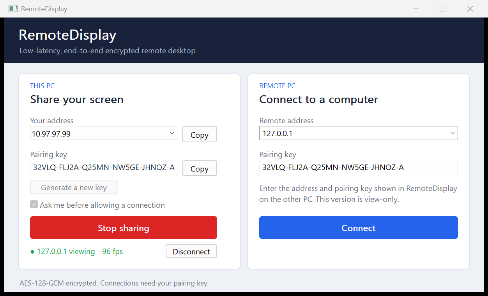

# RemoteDisplay

Low-latency, end-to-end encrypted remote desktop for Windows, written in C++.



## Use it

Build (Visual Studio 2022+ with the C++ desktop workload, CMake 3.20+):

```
cmake -S . -B build
cmake --build build --config Release
```

Run `build\Release\RemoteDisplay.exe` on both PCs.

**On the PC you want to view:** click **Start sharing**. Give the other person your address and
the pairing key shown in the window (Copy buttons are there). The first time, Windows Firewall will
ask to allow the app on private networks: allow it.

**On the PC you are sitting at:** type the other PC's address and pairing key, click **Connect**. A
viewer window opens (F11 toggles fullscreen). Recent connections are remembered.

The sharing PC gets an "Allow this connection?" prompt for each new client (can be turned off), a
Disconnect button, and the pairing key can be regenerated at any time.

Command-line tools for testing and headless use: `rd-host.exe` and `rd-client.exe`.

## Security model

- Every UDP datagram is AES-128-GCM encrypted and authenticated; replays are rejected.
- Key exchange is ephemeral ECDH P-256, bound to the 128-bit pairing key, so a wrong key never
  gets a session and a passive eavesdropper learns nothing.
- Keys are stored with Windows DPAPI (readable only by your Windows user).
- Approving each new connection on the sharing PC is on by default.

## Current limits

- **View only**: no mouse/keyboard control yet.
- **Same network or a reachable address**: no relay or NAT traversal yet, so over the internet you
  need a port-forward (UDP 47800) or a VPN such as Tailscale/WireGuard.
- One viewer at a time; primary monitor only; no audio or clipboard.
- Needs a GPU with a hardware H.264 encoder (NVIDIA, AMD or Intel).
- Windows may omit windows that apps mark as capture-protected from the shared screen.

See [docs/ARCHITECTURE.md](docs/ARCHITECTURE.md) for the pipeline and roadmap.
