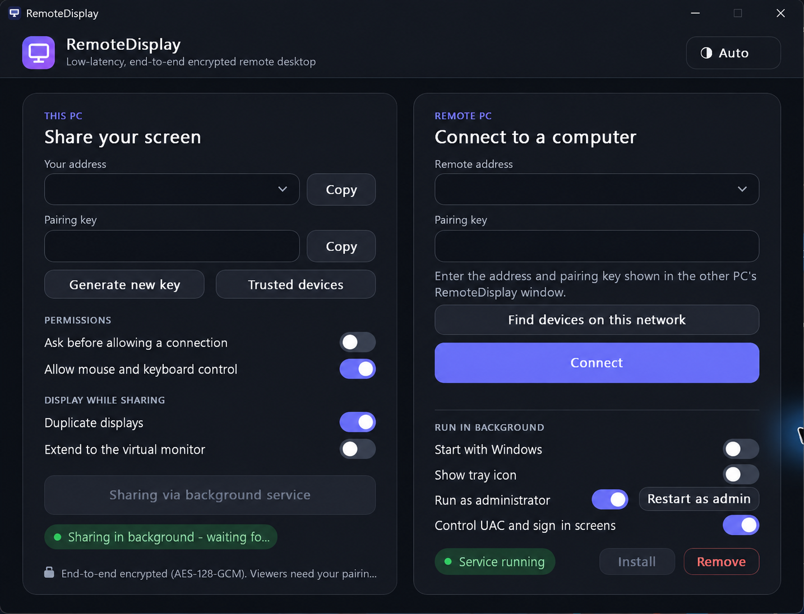
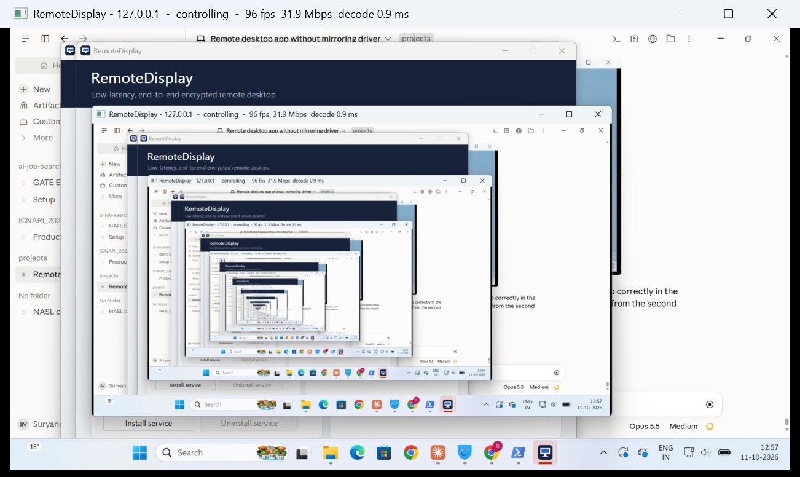
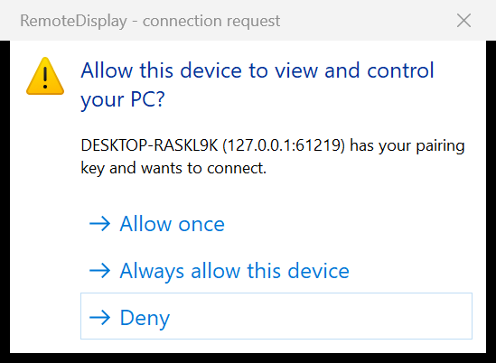

# RemoteDisplay 🖥️🔒

RemoteDisplay is a low-latency, end-to-end encrypted remote desktop for **Windows to Windows** and **Android to Windows**. Share a Windows screen, approve who can connect, then view or control it from another PC or an Android device.



## ✨ Features

- 🖥️ Share and control a Windows desktop with mouse, wheel and keyboard.
- 📱 Connect from the Windows viewer or Android 8.0+ viewer. Discover sharing PCs on the local network and reuse recent connections.
- 🛡️ Encrypt sessions with AES-128-GCM and an ECDH P-256 key exchange bound to a pairing key.
- 👤 Approve new viewers on the host, trust a device for future sessions, or allow view-only access by disabling mouse and keyboard control.
- 🖥️ Duplicate displays or extend to the optional RemoteDisplay virtual monitor.
- 🌙 Choose light, dark or system-matched theme in the Windows app.
- 🚀 Run at sign-in from the tray, or install the optional Windows service for background startup.
- 🔐 With the service installed and administrator consent enabled, view UAC and sign-in/lock screens. They can be controlled when the host runs with administrator rights; otherwise they are view-only.

## 🚀 Quick start

### Download or build

Download installers and viewer builds from [GitHub Releases](https://github.com/suryanshvermaa/RemoteDisplay/releases). The full Windows installer includes the host and viewer. A viewer-only Windows build and an Android APK are also available when published. The optional virtual monitor driver is test-signed and intended for PCs you control; the Android APK is sideloaded rather than distributed through the Play Store.

To build the Windows app, use Windows with Visual Studio 2022 or later and the C++ desktop workload, plus CMake 3.20 or later:

```powershell
cmake -S . -B build
cmake --build build --config Release
```

Run `build\Release\RemoteDisplay.exe` on the Windows PC you want to share.

### Connect

1. On the PC to be viewed, open RemoteDisplay and click **Start sharing**.
2. Share the displayed address and pairing key with the viewer. Use the **Copy** buttons to copy them.
3. On the other Windows PC, enter the address and pairing key and click **Connect**. On Android, choose the PC from **PCs on this network** or enter its address, then enter the key and tap **Connect**.
4. Approve the new connection on the sharing PC. **Always allow this device** remembers the viewer; **Allow once** grants one-time access; **Deny** rejects it.



Click in the Windows viewer to send input. **F11** toggles fullscreen. Windows, Alt+Tab, Alt+Esc and Ctrl+Esc shortcuts go to the remote PC while the viewer is focused. Input is released if the viewer loses focus, closes or disconnects. Keyboard input is sent as hardware scancodes, so the remote PC's keyboard layout determines the resulting characters.

On Android, tap to click, long-press for right click, drag to move or select, and drag with two fingers to scroll. The viewer toolbar provides a keyboard and Esc, Tab and Win keys.

## 🪟 Windows app

The main window has a sharing panel and a connect panel. While sharing, it shows the connection state and offers a disconnect action. The sharing panel includes approval and control settings, display modes, pairing key regeneration and trusted-device management.



The background options include **Start with Windows**, **Show tray icon**, and administrator mode. Closing the window while sharing normally hides it to the tray; the tray menu can reopen the app, start or stop sharing, disconnect a viewer, or exit. You can hide the tray icon too. If approval is disabled, anyone with the pairing key can connect.

The optional Windows service starts with Windows and launches the screen-sharing worker in the signed-in user's session. Install or remove it from **Run in background**; installation requires administrator approval. Sharing starts after a user signs in. The service also runs the helper required for secure-desktop capture.

## 🔐 Secure desktop

Windows normally isolates UAC prompts, sign-in and lock screens on a secure desktop. RemoteDisplay can share these screens when the Windows service is installed and an administrator has enabled **Control UAC and sign-in screens**. The sharing PC must also run with administrator rights to send mouse and keyboard input to them; without that, the screens are view-only. RemoteDisplay cannot interact with Ctrl+Alt+Del. Secure-desktop transitions are recorded in the audit log under `%ProgramData%\RemoteDisplay`.

## 🔒 Security and network

- Video and control traffic use authenticated AES-128-GCM encryption. ECDH P-256 key exchange is bound to the pairing key.
- Each Windows viewer has a persistent device identity protected by Windows DPAPI. A trusted viewer proves its identity on each session; the host stores its public-key fingerprint.
- Approval is on by default for new devices. Regenerating the pairing key invalidates the old key for every viewer.
- RemoteDisplay uses UDP port **47800** by default. Devices can connect on the same network or anywhere the host's UDP port is reachable. The installer adds a firewall rule for private and domain networks.
- There is no relay or automatic NAT traversal. Internet connections may require port forwarding or a VPN such as Tailscale or WireGuard.

## ⚙️ Requirements and limits

- The sharing host requires 64-bit Windows 10 or 11. Direct3D 11 hardware is recommended; capture and encoding can fall back to software.
- The Android viewer requires Android 8.0 or later.
- One viewer can connect at a time. Audio, clipboard sync and file transfer are not supported.
- IME and dead-key text composition is not forwarded as text because keyboard input is sent as scancodes.
- Windows may omit content that an app marks as capture-protected.

## 🧰 Developer notes

The Windows app, host and viewer are written in C++20. The Android viewer is Kotlin and shares the encrypted wire protocol. See [docs/ARCHITECTURE.md](docs/ARCHITECTURE.md) for the streaming pipeline and [android/README.md](android/README.md) for Android build instructions. The `rd-host.exe` and `rd-client.exe` command-line tools are also available in a CMake build.

For secure-desktop manual checks, see [tests/secure_desktop_manual.md](tests/secure_desktop_manual.md).
